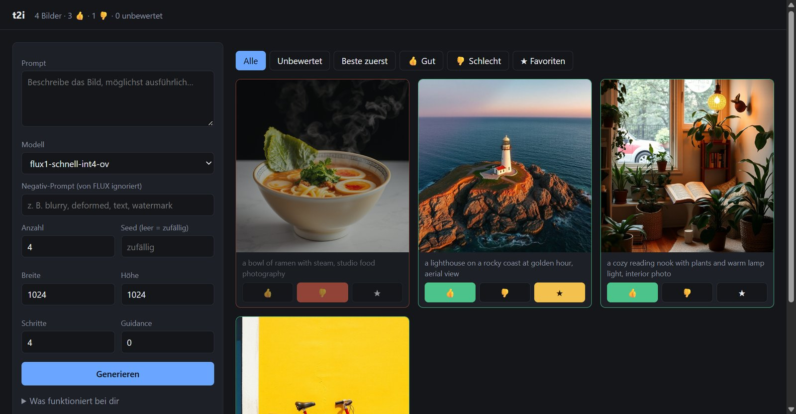
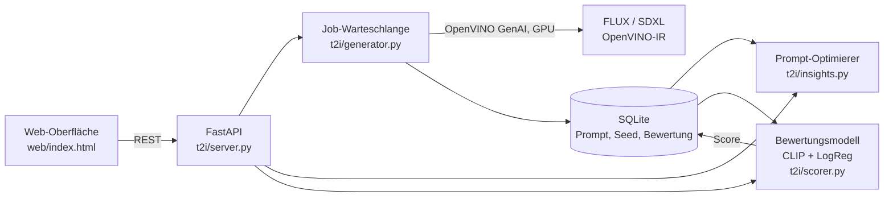

# t2i: lokale Text-zu-Bild-KI, die aus Bewertungen lernt

**Bilder erzeugen, bewerten, und das Werkzeug lernt deinen Geschmack.** t2i läuft komplett offline auf einem
Notebook mit Intel-Arc-GPU (OpenVINO GenAI). Jedes Bild wird mit Prompt, Seed und Parametern gespeichert und kann
mit 👍 / 👎 / ★ bewertet werden. Aus diesen Bewertungen entstehen Prompt-Vorschläge und ein persönliches
Bewertungsmodell, das neue Bilder automatisch einschätzt.

*English: An offline text-to-image workbench for Intel Arc GPUs (OpenVINO GenAI, FLUX/SDXL) that learns from your
ratings: phrase statistics suggest prompt improvements, and a CLIP + logistic-regression scorer ranks new images,
activated only if it beats chance in a permutation test.*



> **Status:** im Eigengebrauch, zum Beispiel für die Bild-Assets der Rätselspiele. Allein entwickelt, mit
> Claude Code als Coding-Agent.

## Warum

Cloud-Bildgeneratoren kosten pro Bild, sehen jeden Prompt und lernen nichts über die eigenen Vorlieben. t2i ist der
Gegenentwurf: Die Bilder entstehen lokal, und die eigenen Bewertungen sind der Datensatz. Die wichtigste
Designfrage dabei: **Wann ist ein Modell, das aus 30 Bewertungen lernt, mehr als Rauschen?**

## Features

- **Generieren:** FLUX.1 schnell (INT4) und SDXL (INT8) als OpenVINO-IR, auch SD 1.5 und SD 3. Modelle werden automatisch
  erkannt und bekommen passende Standardwerte (Schritte, Guidance, Negativ-Prompt). Eine Job-Warteschlange lädt
  immer nur ein Modell gleichzeitig.
- **Bewerten und Verlauf:** 👍 / 👎 / ★ und Notiz je Bild, Filter, Import bestehender Bildordner mit ihren Prompts.
- **Prompt-Optimierer:** Phrasen-Statistik über 👍 und 👎. Vorschläge erscheinen als Chips unter dem Prompt-Feld,
  dazu ein Panel „Was funktioniert bei dir“.
- **Bewertungsmodell:** CLIP ViT-B/32 als feste Bild-Einbettung plus logistische Regression auf die eigenen
  Bewertungen. Es wird **nur aktiv, wenn Kreuzvalidierung und Permutationstest (p < 0,02)** zeigen, dass es besser
  als Zufall ist. Dann bekommen unbewertete Bilder einen Score, „Beste zuerst“ sortiert danach, neue Bilder werden
  automatisch eingeschätzt.

Warum der Permutationstest? Bei etwa 30 Bildern streut die Genauigkeit eines Modells auf reinem Rauschen zwischen
0,3 und 0,8. Eine einzelne gute Kreuzvalidierung beweist also nichts.

## Architektur



## Tech-Stack

| Teil | Technologie |
|---|---|
| Inferenz | OpenVINO GenAI 2026.4 auf Intel Arc 140V (iGPU), wahlweise CPU |
| Modelle | FLUX.1 schnell (INT4), SDXL base (INT8), als OpenVINO-IR |
| Backend | Python 3.12, FastAPI, Uvicorn, SQLite |
| Lernen | CLIP ViT-B/32 (transformers, PyTorch CPU), scikit-learn |
| Oberfläche | eine HTML-Datei ohne Build-Schritt |

## Schnellstart

```powershell
python -m venv .venv
.venv\Scripts\pip install -r requirements.txt
.venv\Scripts\pip install torch==2.14.1 --index-url https://download.pytorch.org/whl/cpu
.venv\Scripts\python -m t2i.server          # dann http://127.0.0.1:7860
```

Modelle (OpenVINO-IR) werden aus `~/tools/imagegen/models` gelesen.

| Variable | Zweck |
|---|---|
| `T2I_MODELS_DIR` | anderer Modellordner |
| `T2I_DEVICE` | `GPU` (Standard) oder `CPU` |
| `T2I_DATA_DIR` | Ablage für Bilder, Datenbank, Compile-Cache (Standard `data/`) |
| `T2I_PORT` | Port (Standard 7860) |

CLIP (~600 MB) wird beim ersten Training geladen. Bestehende Bilder importieren:
`python -m t2i.importer <Ordner>`. Übernommen werden nur Bilder, deren Prompt sich eindeutig zuordnen lässt.

## Aufbau

```
t2i/config.py      Pfade, Modell-Erkennung, Standardwerte je Modellfamilie
t2i/db.py          SQLite: Bilder, Bewertungen, Einbettungen
t2i/generator.py   Job-Warteschlange + Worker
t2i/server.py      FastAPI-Endpunkte
t2i/insights.py    Phrasen-Statistik und Prompt-Vorschläge
t2i/scorer.py      CLIP-Einbettung, Training mit Signifikanzprüfung, Scoring
t2i/importer.py    Import bestehender Bildordner
web/index.html     Oberfläche
```

## Fahrplan

1. ✅ Generieren, bewerten, Verlauf
2. ✅ Import bestehender Bilder
3. ✅ Prompt-Optimierer
4. ✅ Bewertungsmodell mit Signifikanzprüfung
5. LoRA-Training auf Favoriten (PyTorch-XPU oder gemietete GPU), Versionierung und A/B-Vergleich

## Lizenz

Noch offen. Für die Modelle gelten deren eigene Lizenzen (FLUX.1 schnell: Apache 2.0, SDXL: CreativeML Open RAIL++-M).
